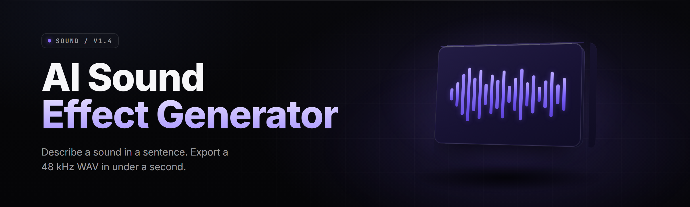

  
  
  

  

  
  

---

**Type a vibe. Get the WAV.** A proc-gen SFX workstation for game devs, modders, and sound designers who'd rather prompt than crate-dive.

---

## 🎚️ Overview

| Category | Details |
|---|---|
| What it is | Windows desktop suite that turns text prompts + reference audio into finished SFX (WAV/OGG/FLAC) |
| Engine | Diffusion-over-latents text-to-audio + FM/Foley hybrid synth backend |
| Output | 24bit/48kHz masters, auto-loop points, auto-normalize to -14 LUFS |
| Distribution | Single portable `.exe`, no installer required, extracts and runs |
| Format | Mods, games, trailers, foley, UI clicks, ambience, stingers |

The AI Sound Effect Generator Toolkit is a local-first sound design bench. You describe the sound — "wet sewer pipe drip, distant, reverb tail 1.2s" — and the engine renders it into a layered stem you can further mangle in the built-in editor. No cloud round-trips, no token limits, no plugins to wire up.

---

## 📖 What is an AI Sound Effect Generator

| Term | Explanation |
|---|---|
| Prompt-to-SFX | Text description converted into a raw audio latent, then decoded to waveform |
| Latent diffusion (audio) | Noise shaped in a compressed audio space rather than raw samples — fast + coherent |
| Reference transfer | Feed a 3–10s clip; the engine borrows timbre/texture without copying content |
| Stem stack | Every render splits into Transient / Body / Tail layers for individual tweak |
| Auto-loop | Engine detects zero-crossing seams and writes seamless loop points into metadata |
| Bounce profile | Target preset for game engines (Unity, Unreal, Godot, Wwise, FMOD) |
| Role morph | Morph between two prompts on a slider — "metallic → organic" without re-rolling |

**Why people reach for it:**

- 🔉 One-line prompt replaces 40 minutes of foley log hunting
- 🧩 Stems, not monoliths — edit pieces instead of re-rendering the whole thing
- 🎯 Bounce profiles mean the file drops into your engine at correct gain the first time
- 🕹️ Built for iteration — 12 renders/sec on the low-latency model
- 🧊 Offline-first: everything runs on the box, projects stay self-contained

---

## 🗂️ Module Catalog

### ⚙️ Prompting & Input

A prompt is not a string — it's a stacked parameter object. The toolkit parses natural language into tonal, temporal, and spatial embeddings, and lets you correct any axis.

- **Prompt Parser** — splits free text into mood / material / distance / movement
- **Negative Prompt Stack** — latch unwanted textures (hiss, clipping, dialogue bleed)
- **Reference Transfer Slot** — 3–10s wav as sonic anchor, content-safe
- **Seed Lock + Braid** — pin one render, re-roll the tail deterministically
- **Macro Tokens** — `{metallic}`, `{organic}`, `{foley}`, custom banks
- **Prompt History Graph** — visual branches; snap back to any earlier take

### 🧠 Synthesis Engines

Six engines, one project. Swap engine per-layer.

- **Ambience Cloud** — pads, rooms, distant hums, wind, non-transient bodies
- **Impact Lab** — hits, slams, cracks, breaks; transient-first framing
- **Foley Booth** — footfalls, cloth, glass, ceramic, props, small object work
- **UI Clickery** — menus, toggles, notifications, cursor sfx, sci-fi twinkles
- **Sci-Fi Reactor** — hums, sweeps, charge-ups, alert sirens, robotic vocal chop
- **Hybrid FM** — operator-style tones for arcade / retro / abstract mods

### ✂️ Editing & Post

The editor is single-window and does one thing obsessively: keeps position explicit.

- **Stem Splitter** — separate render into Transient / Body / Tail
- **Pitch / Stretch Grid** — independent time & pitch, key-lock option
- **Auto-Seam Loop Tool** — writes WAV/AIFF loop metadata for engine import
- **Loudness Matching** — -14 / -16 / -23 LUFS presets per target platform
- **Micro-Comp / Saturation** — glue without pumping
- **Regex Timeline Search** — find every "click" every render, everywhere

### 🌧️ Environment & Reverb

Space is a parameter, not a plugin chain.

- **Room Designer** — the toolkit models 3×3m booth → cathedral → metal corridor
- **Position Radar** — place the source in a spherical field, eye-locked to camera
- **Propagation Sim** — reverb tails computed, not multiplied
- **Bus Placeholder** — output can dry + wet split for your game mix

### 📦 Export & Pipeline

Everything is designed around dropping into an engine on the first try.

- **Bounce Profiles** — Unity, Unreal, Godot, Wwise, FMOD, plain WAV
- **Batch Queue** — render 200 variants overnight
- **Naming Provenance** — deterministic names with prompt hash baked in
- **Version Snapshots** — branch a project, keep every take
- **Asset Sheet Export** — CSV manifest for your audio team
- **Silence Stripper** — trims dead heads/tails at 3 different thresholds

### 🧪 Creative Utilities

- **Prompt Mutator** — auto-riff on an existing prompt into 20 new takes
- **Transfer Bench** — A/B against a reference; renders next to reference, same length
- **Spectral Preview** — spectrogram view alongside waveform view
- **Modder Mode** — auto-trim to 0.5s / 1s / 2s slices for engine loops
- **World Folder** — drop into any Unity Resources folder and the project auto-indexes

---

| Module | Status | Description |
|---|---|---|
| Prompt Parser | ✅ Working | NL → tonal/temporal/spatial axes |
| Diff-Audio Core | ✅ Working | 4-latent diffusion, 48kHz decode |
| Reference Transfer | ✅ Working | clip-anchored render |
| Stem Splitter | ✅ Working | 3-band automatic split |
| Auto-Loop Writer | ✅ Working | zero-cross seam detection |
| Bounce Profiles | ✅ Working | 6 engine presets |
| Batch Queue | ✅ Working | 200+ item overnight |
| Spectral Preview | ✅ Working | 8192-pt FFT live view |
| Hybrid FM Engine | ✅ Working | retro/arcade timbre |
| Bus Placeholder | ✅ Working | dry/wet paired export |
| Naming Provenance | ✅ Working | hash-baked filenames |
| Version Snapshots | ✅ Working | per-project git-style tree |

---

## 🧨 The Problem

Most modders and small games devs face the same wall.

- Sample packs are priced for studios and shrink-wrapped in EULAs that scare lawyers
- Clicking through Soundly, Freesound, BOOM, and a Discord backup takes longer than the sfx will ever be heard
- Pitch shifting a stock footstep 12 semitones sounds like a footstep that got peed on
- You can never find "the" metal impact that matches the metal the artist drew
- Layering 4 sounds is a comping problem and your DAW doesn't want to help
- Reference-matching by ear always drifts toward generic — your robo-chirp becomes everyone's robo-chirp
- Offline designers get punished; browser tabs don't integrate with a game's asset pipeline

---

## 🧩 The Solution

| Problem | Solution |
|---|---|
| Studio price, indie wallet | One flat toolkit, unlimited local renders |
| Crate-diving eats the day | Prompt + reference → first-draft in 4s |
| Naive pitch shifts go unnatural | Gradient-shape morph on stem layer |
| Generic robo-chirp same as everyone's | Reference transfer keys the timbre to your project |
| Comping sprawl | Automatic 3-lane stem stack per render |
| Reverb doesn't sit right | Room Designer couples geometry to tail |
| Post-process is a second job | Bounce Profiles hit engine targets directly |
| Naming & versioning chaos | Deterministic hash names + visual branch tree |

---

## 🖱️ Quick Start

1. 📄 Visit the project page and download the release archive for Windows 10/11 (x64)
2. 📂 Extract the archive to any folder — no installer, portable by design
3. 🚀 Double-click `.exe` — first launch may prompt for a writable content folder
4. 🧪 Type a prompt in the top field — press **Render** or hit `Space`. Drag any stem from the pile on the right into the timeline
5. 💾 Export: pick a Bounce Profile, choose a folder, hit **Batch Queue**

---

## 🧮 Comparison

| Aspect | Traditional Sample Pack | Browser TTS-to-audio Toy | This Toolkit |
|---|---|---|---|
| Turnaround | Search for hours | Diffuse, no controls | Prompt → stem in ~4s |
| Offline use | Yes | No | Yes, fully local |
| Prompt is editable | N/A | Non-deterministic | Deterministic, braided |
| Engine-ready output | Manual config | Manual config | Bounce Profiles |
| Stems & layers | No | No | 3-lane per render |
| Reference-guided | No | Weak | Own engine slot |
| Batch render | No | Rate-limited | Local queue, no cap |
| Version tree | No | No | Snapshot branches |

---

## 🛠️ System Requirements

| Component | Minimum | Recommended |
|---|---|---|
| OS | Windows 10 x64 21H2 | Windows 11 x64 24H2 |
| CPU | 6 cores, AVX2 | 12+ cores, AVX-512 |
| RAM | 12 GB | 32 GB |
| GPU | CUDA 11+, 6 GB VRAM | CUDA 12+, 12 GB VRAM |
| Storage | 6 GB free (audio + models) | SSD, 24 GB free (project bank) |
| Audio | Any WASAPI device | Dedicated interface, ASIO |
| Runtime | Bundled in `.exe` | Bundled in `.exe` |

---

## 📥 Installation

1. **Download the archive.** The release ships as a single `.exe` alongside a small model pack. Everything runs from the folder — no separate runtime install.
2. **Extract anywhere** with write access. Avoid `C:\Program Files` — Windows Defender makes sandboxing friendly tools misbehave there.
3. **Run the `.exe`.** Windows may show a SmartScreen prompt on first launch; click **More info → Run anyway**. On the first run, the toolkit builds its content catalog and asks for a folder to store renders.

No `pip`, no `npm`, no `git clone`. This is a run-what-you-got project.

---

## 🔍 Known Issues

| Issue | Solution |
|---|---|
| First render slower than later ones | Model warm-up — 2nd take is roughly 4× faster |
| SmartScreen warning on launch | Unsigned 2026 build; use **More info → Run anyway** |
| WAV loop points not read by some engines | Export with the "Wwise" or "Unity" Bounce Profile |
| GPU fallback to CPU slows renders | Update GPU drivers to CUDA 12.4 or newer |
| Project folder prompts on launch | Point the toolkit at any user folder it can write to |
| Reference clip import fails on 96kHz | Engines expect 44.1/48kHz; resample your anchor first |

---

## 💬 FAQ

**Q:** Will my antivirus flag the `.exe`?
**A:** Unsigned developer tools sometimes trip heuristics. The suite is open-source; you can rebuild from source if you prefer, or whitelist the folder after a scan. The single `.exe` approach is deliberate — no registry writes, no service installs.

**Q:** Does it work if I don't have a CUDA GPU?
**A:** Yes. Renders drop to CPU fallback; takes run slower (single-digit seconds instead of ~0.1s) but quality is identical. Team machines without dGPUs are a supported path.

**Q:** Can I use the outputs in commercial games?
**A:** The toolkit is MIT; renders are yours. Model weights ship per their own licenses — check `THIRD_PARTY.txt` if you plan to redistribute the weights themselves, not the audio.

**Q:** Does it integrate with Steam, Unreal, Unity, or Godot?
**A:** Bounce Profiles are the integration. Point the profile at your project's audio folder, render, done. No plugin to install on the engine side.

**Q:** Do I need admin rights?
**A:** No. Run from a user folder without elevation. Only the Windows Firewall can prompt the first time — the suite never talks to the network except to check for updates.

**Q:** How often do updates ship?
**A:** Nightly builds land on the release page; tagged stable releases are monthly. Engine core version is written into every project snapshot.

---

## 🎁 What You Get, Exactly

| Feature | Free End-User Build |
|---|---|
| Engines | All 6 |
| Batch size | Unlimited local |
| Stems per render | 3 (Transient, Body, Tail) |
| Bounce Profiles | 6 SDK targets |
| Model pack | NVIDIA / AMD / CPU |
| Offline | Full |

---

  

---

The toolkit exists because crate-diving is a tax on creativity that should have been abolished years ago. If it holds up in your project — good. If it doesn't, open an issue, drop the failing prompt + the render output, and it'll ship in the next nightly. 6767, go make noise.

  

